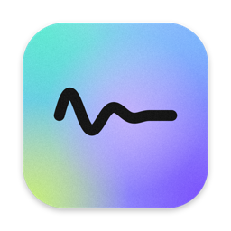

<p align="center">
  
</p>

<h1 align="center">Tacet</h1>

<p align="center">Noise cancelling for your Mac's screen.</p>

---

On a big monitor it's easy to have a dozen windows open and all of them asking for attention. Tacet quiets the ones you're not using. The window you're working in stays sharp, and everything behind it softens into a blur. Leave a window alone for a while and it fades a little further back.

*Tacet* is the word in sheet music that tells a player to stay silent for a passage. That's the idea here: everything except your window rests.

## What it does

- **Blurs everything but your focused window.** Switch apps and the blur follows you.
- **Turns itself on.** Settle into one app for a bit while typing or scrolling and the blur fades in. Start hopping between apps and it fades out again, because you're probably looking for something.
- **Lets old windows recede.** A window you haven't touched in 5 minutes gets a little darker, and darker again after 30.
- **Keeps some apps clear.** Add apps like your editor and terminal to *Always clear* and they never blur.
- **Sets itself up from a sentence.** Type what you're working on, like "writing my thesis, need my references", and Apple's on-device model picks which of your open apps to keep clear and how deep to blur. Undo puts your own setup back.
- **Stays out of the way.** No hotkeys to learn and no Dock icon. It's a small dial in the menu bar that fills up as the blur gets deeper.

Click the dial and a Control Center–style panel drops down: the "What are you working on?" field, a switch for the blur, a switch for Auto-focus, a Depth slider, and your Always clear apps. Everything else, like opening at login, how quickly Auto-focus reacts and how dark old windows get, is in **Tacet Settings…** at the bottom of the panel or in the dial's right-click menu.

## Privacy

Tacet asks for no permissions. It doesn't record your screen and doesn't read what you type. macOS draws the blur itself, and Auto-focus only checks *how long ago* a key was pressed, never which key. "What are you working on?" runs on Apple's on-device model and only sees your sentence and the names of your open apps. Nothing leaves your Mac.

## Install

1. Download the latest `Tacet-x.y.z.dmg` from [Releases](../../releases).
2. Open it and drag Tacet into Applications.
3. The first time, right-click Tacet in Applications and choose **Open**. Tacet isn't notarized by Apple yet, so macOS asks once.

You'll need macOS 26 (Tahoe) or later. Tacet runs on Apple silicon and Intel Macs. "What are you working on?" needs Apple Intelligence turned on, so it only appears on Apple silicon Macs.

## Known rough edges

- If you plug in or unplug a display, quit and reopen Tacet so it covers the new screen layout.
- An Always clear window is cut out of the blur as a rectangle. Anything stacked on top of it shows through sharp too.

## Build it yourself

You'll need Xcode 26 or the Swift 6.2 toolchain.

```bash
swift run      # build and start Tacet from the terminal
swift test     # run the tests
scripts/make-dmg.sh 1.0.0   # build Tacet.app and dist/Tacet-1.0.0.dmg
```

### Releasing

Push a version tag and GitHub Actions runs the tests, builds the DMG and publishes the release:

```bash
git tag v1.0.0 && git push origin v1.0.0
```

### How the code is laid out

```
Tacet/
├── Package.swift
├── Sources/
│   ├── App/      Entry point and the saved settings
│   ├── Panel/    Menu bar dial, the Liquid Glass control panel, and the Settings window
│   ├── Engine/   The blur under the focused window and the darker layers over windows left alone
│   └── Focus/    Auto-focus, and turning "what are you working on?" into a setup
├── Tests/
├── Assets/       App icon
├── scripts/      make-dmg.sh
└── .github/workflows/release.yml
```

The blur is a click-through window holding an `NSVisualEffectView`, placed directly underneath whichever window is in front. That's why Tacet doesn't need Screen Recording permission.

The icon is the Lull logo.

## License

MIT. See [LICENSE](LICENSE).
